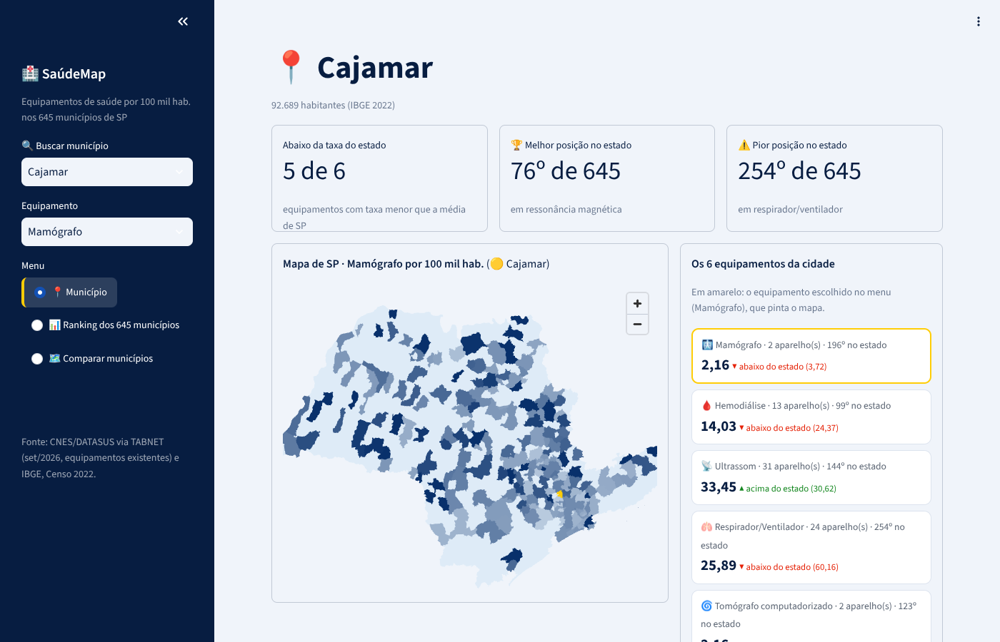
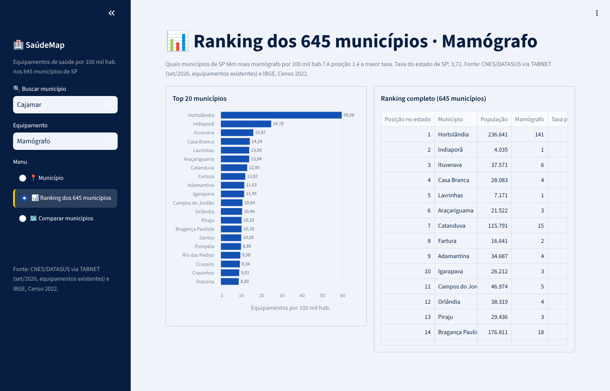
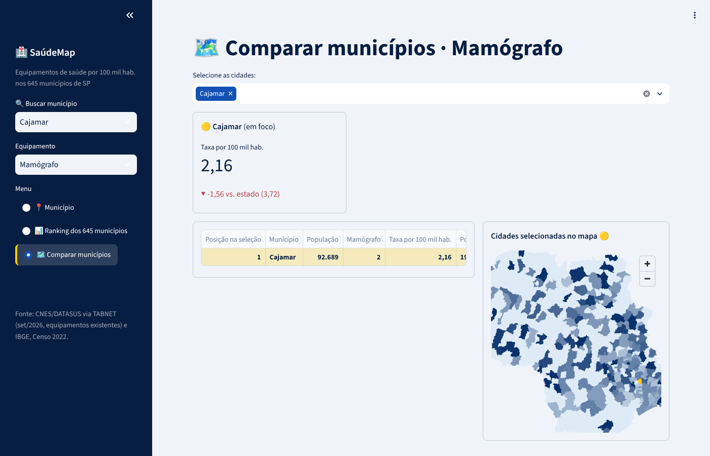

# 🏥 SaúdeMap
🔗 **Acesse o app:** https://saudemap.streamlit.app

**Motor de busca de informações territoriais para apoio à gestão pública em saúde.**

Onde falta ressonância, mamógrafo ou hemodiálise no estado de São Paulo? O SaúdeMap cruza os equipamentos de saúde cadastrados no CNES/DATASUS com a população do IBGE e mostra, para cada um dos 645 municípios paulistas, quantos aparelhos existem por 100 mil habitantes. A ideia é ajudar gestores públicos a identificar vazios assistenciais.

Projeto Integrador 3 do curso de Ciência de Dados da Fatec Santana de Parnaíba (2026), apresentado na 3ª Mostra Acadêmica da Fatec.



## O que o app faz

- **Município:** cartões com a taxa de 6 equipamentos (ressonância, tomógrafo, mamógrafo, ultrassom, hemodiálise e respirador), comparação com a taxa do estado, posição no ranking e mapa com a cidade em destaque.
- **Ranking dos 645 municípios:** gráfico e tabela com o ranking do estado para o equipamento escolhido.
- **Comparar municípios:** escolha várias cidades e compare as taxas lado a lado, com a taxa do estado como referência.

| Ranking | Comparar |
|---|---|
|  |  |

## Como funciona

1. **Equipamentos:** extraídos do TABNET/DATASUS (CNES, equipamentos existentes, competência set/2026), já agrupados por município.
2. **População:** Censo 2022 do IBGE.
3. **Junção:** o CNES usa o código de município com 6 dígitos e o IBGE com 7. O código de 6 dígitos é o do IBGE sem o dígito verificador. A junção parte da tabela do IBGE, para incluir os municípios sem nenhum aparelho.
4. **Indicador:** taxa = quantidade de aparelhos ÷ população × 100.000, seguida do ranking estadual.
5. **Mapa:** malha dos municípios de SP ([geodata-br](https://github.com/tbrugz/geodata-br)) desenhada com pydeck.

## Tecnologias

Python · pandas · Streamlit · Altair · pydeck

## Como rodar

```bash
pip install -r requirements.txt
streamlit run Motor_de_Busca.py
```

## Arquivos

| Arquivo | Conteúdo |
|---|---|
| `Motor_de_Busca.py` | O aplicativo |
| `tabnet_equipamentos_SP_existente.csv` | Equipamentos por município (TABNET/CNES, set/2026) |
| `Agregados_por_municipios_basico_BR.csv` | População dos municípios de SP (IBGE, Censo 2022) |
| `sp_municipios.geojson` | Malha dos municípios de SP |
| `.streamlit/config.toml` | Tema visual |

## Limitações

- População de 2022 e equipamentos de 2026.
- Contamos aparelhos **existentes**, não só os disponíveis ao SUS.
- Municípios muito pequenos podem ter taxas altas com um único aparelho.

## Fontes

- DATASUS. TABNET – CNES, Recursos Físicos, Equipamentos (São Paulo).
- IBGE. Censo Demográfico 2022, Agregados por municípios.
- Brugnara, T. geodata-br.
